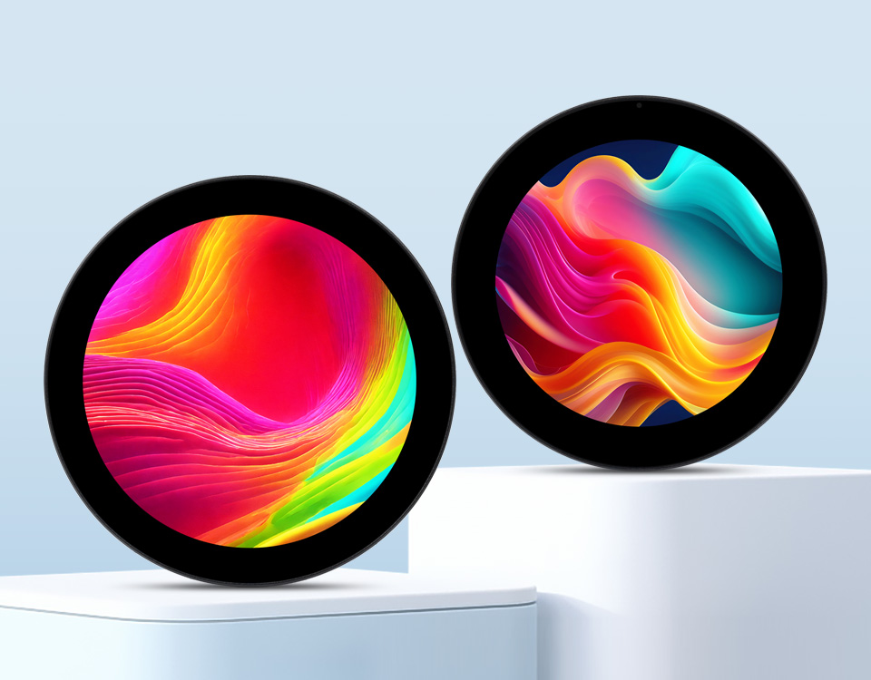

<div align="center">
  <h1>ESP32-P4-WIFI6-Touch-LCD-XC</h1>
  <p><strong>搭载 Wi-Fi 6 的 ESP32-P4 3.4 / 4 英寸圆形 IPS 触控屏开发板</strong></p>
  <p>
    <a href="https://github.com/waveshareteam/ESP32-P4-WIFI6-Touch-LCD-XC/actions/workflows/esp-idf-projects.yml"></a>
    <a href="https://github.com/waveshareteam/ESP32-P4-WIFI6-Touch-LCD-XC/actions/workflows/arduino-projects.yml"></a>
    <a href="LICENSE"></a>
  </p>
  <p>
    <a href="README.md">English</a> ·
    <a href="https://www.waveshare.net/shop/ESP32-P4-WIFI6-Touch-LCD-3.4C.htm">🌐 产品系列</a> ·
    <a href="https://docs.waveshare.net/ESP32-P4-WIFI6-Touch-LCD-XC/">📚 产品文档</a> ·
    <a href="docs/FIRMWARE_ZH.md">📦 固件源码</a> ·
    <a href="examples/esp-idf/">🧩 ESP-IDF 示例</a> ·
    <a href="examples/arduino/">🔧 Arduino 示例</a>
  </p>
  
</div>

---

## ✨ 产品概述

本仓库提供适用于微雪 ESP32-P4-WIFI6-Touch-LCD-XC 系列开发板的
ESP-IDF 示例、Arduino 示例及配套库、ESP-Brookesia 固件源码、硬件资料和
开发文档。

两种型号均采用 ESP32-P4 应用处理器、ESP32-C6 无线协处理器和圆形
MIPI-DSI 触控屏，适合用于图形化人机交互、多媒体应用、边缘计算、智能家居
控制和交互式仪表盘。

## 🖥️ 产品型号

| 型号 | SKU | 屏幕 |
| --- | ---: | --- |
| [ESP32-P4-WIFI6-Touch-LCD-3.4C](https://www.waveshare.net/shop/ESP32-P4-WIFI6-Touch-LCD-3.4C.htm) | 31523 | 3.4 英寸圆形 IPS LCD，800 × 800 |
| [ESP32-P4-WIFI6-Touch-LCD-4C](https://www.waveshare.net/shop/ESP32-P4-WIFI6-Touch-LCD-4C.htm) | 31522 | 4 英寸圆形 IPS LCD，720 × 720 |

## 🖥️ 硬件概览

| 功能 | 器件 / 接口 |
| --- | --- |
| 应用处理器 | ESP32-P4NRW32，双核高性能 RISC-V 最高 360 MHz，低功耗 RISC-V 核最高 40 MHz |
| 存储 | 封装内置 32 MB PSRAM，板载 32 MB NOR Flash |
| 无线连接 | ESP32-C6-MINI-1 通过 SDIO 提供 2.4 GHz Wi-Fi 6 和 Bluetooth 5 (LE) |
| 显示 | 2-lane MIPI-DSI 圆形 IPS LCD；3.4 英寸 800 × 800 或 4 英寸 720 × 720。两种屏均为 1,500 Mbps/lane 和 80 MHz DPI 时钟。 |
| 触控 | 官方硬件采用 GT9271 电容触控控制器；示例使用带地址探测和轮询的托管 GT911 兼容驱动/API。 |
| 摄像头 | 2-lane MIPI-CSI 摄像头接口 |
| 音频 | ES8311 音频编解码器、ES7210 音频 ADC、板载麦克风和 8 Ω / 2 W 扬声器接口 |
| 存储卡与 USB | SDIO 3.0 microSD 卡槽和 USB 2.0 OTG High-Speed |
| 扩展 | 40PIN GPIO、ESP32-C6 UART、ESP32-P4 调试接口和 RTC 电池接口 |
| 硬件资料 | [开发板原理图](hardware/schematics/ESP32-P4-WIFI6-Touch-LCD-XC-Schematic.pdf) |

完整规格、接口说明、尺寸和使用教程请参阅
[官方中文产品文档](https://docs.waveshare.net/ESP32-P4-WIFI6-Touch-LCD-XC/)。

## 🚀 快速开始

CI 使用 ESP-IDF `v5.5.5` 和 `v6.0.2` 测试全部一方 ESP-IDF 工程。

所有示例默认使用 `rev3_x` ESP32-P4 芯片 profile。启用 PSRAM 时，默认 ESP-IDF 配置
使用 250 MHz，对应 Arduino FQBN 使用 `ChipVariant=postv3`。`rev1_3` 是面向 pre-v3
芯片的显式兼容配置，会把已启用的 PSRAM 限制为 200 MHz，不是第二套默认示例矩阵。`rev1_3` 与 `rev3_x`
的二进制文件不能互换。这些是芯片 profile，不是 PCB 版本，不能据此判断开发板版本。

DSI PHY 参考时钟方面，pre-v3 使用旧版 PLL_F20M，rev3.x 使用 XTAL。托管 BSP
通过 `.phy_clk_src = 0` 让 ESP-IDF 按芯片 profile 自动选择；Arduino 显示适配器也
遵循同一套 rev3.x 安全选择。切换 PHY 参考源时不要改动 80 MHz DPI 时钟。

```bash
cd examples/esp-idf/02_HelloWorld
idf.py set-target esp32p4
idf.py build
idf.py -p PORT flash monitor
```

请将 `PORT` 替换为开发板对应的串口。使用 Wi-Fi、媒体文件、显示选项或其他
板级配置的示例可能需要先运行 `idf.py menuconfig`。

环境配置及更多说明请参阅
[入门指南](docs/GETTING_STARTED_ZH.md)。

## 🧪 示例

### ESP-IDF

| 示例 | 功能 |
| --- | --- |
| [01_HowToCreateProject](examples/esp-idf/01_HowToCreateProject/) | 最小 ESP-IDF 工程结构 |
| [02_HelloWorld](examples/esp-idf/02_HelloWorld/) | 基础应用与开发板启动 |
| [03_i2c_tools](examples/esp-idf/03_i2c_tools/) | I2C 扫描与命令工具 |
| [04_wifistation](examples/esp-idf/04_wifistation/) | 通过 ESP32-C6 协处理器连接 Wi-Fi |
| [05_sdmmc](examples/esp-idf/05_sdmmc/) | microSD 与 SDMMC 访问 |
| [06_I2SCodec](examples/esp-idf/06_I2SCodec/) | I2S 音频编解码输入与输出 |
| [07_Displaycolorbar](examples/esp-idf/07_Displaycolorbar/) | MIPI-DSI LCD 彩条显示 |
| [08_lvgl_demo_v9](examples/esp-idf/08_lvgl_demo_v9/) | LVGL 9 显示与触控 |
| [09_video_lcd_display](examples/esp-idf/09_video_lcd_display/) | 摄像头到显示屏的视频链路 |
| [10_mp4_player](examples/esp-idf/10_mp4_player/) | MP4 / AVI 媒体播放 |
| [11_esp_brookesia_phone](examples/esp-idf/11_esp_brookesia_phone/) | ESP-Brookesia 类手机界面 |
| [12_usb_extend_screen](examples/esp-idf/12_usb_extend_screen/) | USB 扩展屏 |

仓库维护的 ESP-Brookesia 固件应用位于
[`firmware/brookesia`](firmware/brookesia/)。

### Arduino

| 示例 | 功能 |
| --- | --- |
| [01_HelloWorld](examples/arduino/examples/01_HelloWorld/) | 显示屏启动 |
| [02_AsciiTable](examples/arduino/examples/02_AsciiTable/) | 文本与字符渲染 |
| [03_Drawing_board](examples/arduino/examples/03_Drawing_board/) | 电容触控画板 |
| [04_LVGLV9_Arduino](examples/arduino/examples/04_LVGLV9_Arduino/) | LVGL 9 显示与触控 |
| [05_GFX_ESPWiFiAnalyzer](examples/arduino/examples/05_GFX_ESPWiFiAnalyzer/) | Wi-Fi 扫描与信道可视化 |
| [06_Camera_Preview](examples/arduino/examples/06_Camera_Preview/) | 摄像头预览 |
| [07_Camera_ISP_Tuning](examples/arduino/examples/07_Camera_ISP_Tuning/) | 摄像头 ISP 调节 |
| [08_SD_Card](examples/arduino/examples/08_SD_Card/) | microSD 卡访问 |
| [09_Audio_Playback](examples/arduino/examples/09_Audio_Playback/) | ES8311 音频播放 |
| [10_Mic_Record](examples/arduino/examples/10_Mic_Record/) | ES7210 麦克风采集 |

配套库位于
[`examples/arduino/libraries`](examples/arduino/libraries/)，其中上游库自带的示例
不属于本产品的一方示例。依赖和当前平台说明请参阅
[Arduino 说明](examples/arduino/README_ZH.md)。

## ✅ 持续集成

| 范围 | 当前覆盖 |
| --- | --- |
| 仓库自检 | 文档、工程结构与一方 Arduino 示例目录 |
| ESP-IDF | 12 个一方工程 × ESP-IDF `v5.5.5`/`v6.0.2`：01–06 在每个 ESP-IDF 版本各构建一个共享的非显示配置（12 个任务），07–11 同时构建 3.4C 与 4C 显示配置（20 个任务），USB 同时构建双显示配置及 default/vendor-only 配置（8 个任务）；完整路由共 40 个任务 |
| Arduino | 10 个一方 `rev3_x` 示例，Arduino-ESP32 `3.3.11`，同时编译 3.4C 与 4C 配置（20 个任务） |
| 维护固件 | `firmware/brookesia` 使用 ESP-IDF `v5.5.5`，构建两个屏幕及 `rev3_x` / `rev1_3` 配置 |

每个 Pull Request 都会得到可见的策略、ESP-IDF 路由和 Arduino 路由结论。纯文档
改动会跳过产品构建；源码或共享构建输入只选择受影响矩阵；未知路径会先保守选择
双完整矩阵，再使策略检查失败。`firmware/` 下维护中的源码工程会选择单独的双显示 profile
固件工作流，但不会进入默认示例矩阵；配置后的完整产物集合共 64 项（40 ESP-IDF 示例 + 20 Arduino
示例 + 4 个维护固件任务）。配套库自带的上游示例不会进入发现矩阵。详细行为请参阅
[持续集成说明](docs/CI_ZH.md)。

## 🗂️ 仓库结构

| 路径 | 用途 |
| --- | --- |
| [`examples/esp-idf/`](examples/esp-idf/) | ESP-IDF 一方工程 |
| [`examples/arduino/`](examples/arduino/) | Arduino 一方示例与配套库 |
| [`firmware/`](firmware/) | 开发板固件源码工程 |
| [`hardware/`](hardware/) | 原理图和硬件参考资料 |
| [`docs/`](docs/) | 入门、结构、CI 和故障排查文档 |
| [`assets/`](assets/) | 文档使用的产品图片 |
| [`.github/`](.github/) | GitHub Actions 工作流与 CI 脚本 |

## 📚 文档

- [官方中文产品文档](https://docs.waveshare.net/ESP32-P4-WIFI6-Touch-LCD-XC/)
- [官方英文产品文档](https://docs.waveshare.com/ESP32-P4-WIFI6-Touch-LCD-XC)
- [入门指南](docs/GETTING_STARTED_ZH.md)
- [Arduino 分段烧录与 Hardware CDC](docs/ARDUINO_FLASHING_ZH.md)
- [示例索引](examples/README_ZH.md)
- [工程结构](docs/PROJECT_STRUCTURE_ZH.md)
- [持续集成](docs/CI_ZH.md)
- [组件归属](docs/COMPONENTS_ZH.md)
- [硬件审计](docs/HARDWARE_ZH.md)
- [固件源码边界](docs/FIRMWARE_ZH.md)
- [故障排查](docs/TROUBLESHOOTING_ZH.md)
- [开发板原理图](hardware/schematics/ESP32-P4-WIFI6-Touch-LCD-XC-Schematic.pdf)

## 🤝 支持与贡献

欢迎提交贡献和可复现的问题报告。请包含产品型号与硬件版本、示例路径、框架版本、
复现步骤、预期行为、实际行为以及相关串口日志。

- [提交 Issue](https://github.com/waveshareteam/ESP32-P4-WIFI6-Touch-LCD-XC/issues)
- [官方中文产品文档](https://docs.waveshare.net/ESP32-P4-WIFI6-Touch-LCD-XC/)
- 如需订单相关技术支持，请联系微雪并提供订单号。

## 📄 许可证

本仓库采用 Apache License 2.0 许可证，详情请参阅
[LICENSE](LICENSE)。
